# Effects library (97)

Every effect was invented for one moment of one film. Use it as `fx="code:@<name>;<param>:<value>…"`, adapt a copy under a new name, or invent a new one and save it (`node tools/pp_fx.mjs save …`).

| preview | effect | what it does | params | tags | born in |
|---|---|---|---|---|---|
| 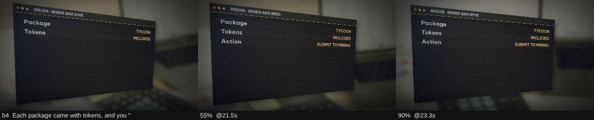 | `@backoffice` | a company back-office screen as a tilted 3D panel in front of real footage: data rows type in on cue, a hero value types, doubles, counts down or flips on a word; the screen is the world of a database that pretends | bg, title, rows, go, gap, hero, hlab, hat, to, toat, timer, tat, note, ry, in, out, accent | database, screen, ui, data, numbers, typing, 3d, fake | onecoin v2 (the coin was a row in a database) |
| 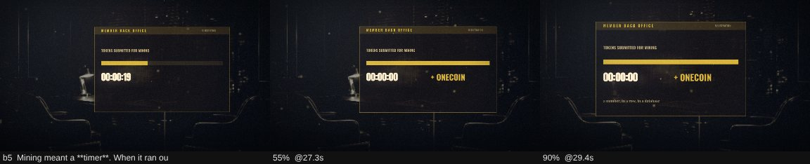 | `@backoffice_screen` | a glass member back-office screen floating over a plate, in 3 modes: a mining timer that fills then pays out, an admin price field being typed, a balance that only grows | mode, plate, go, x, title | ui,screen,database,fake,timer,balance,price | onecoin a2: Mining meant a timer / The office in Sofia typed it in / your balance only ever grew |
| 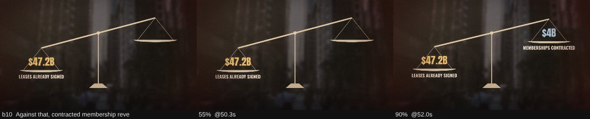 | `@balance_scale` | a beam scale over a real picture; one pan is loaded on its word, then the other, and the beam tips by the true ratio of the two values | in, out, bg, lv, rv, lat, rat, l, r | comparison,ratio,scale,weight,mismatch,numbers | wework a3-10: against that, contracted membership revenue of about four billion |
| 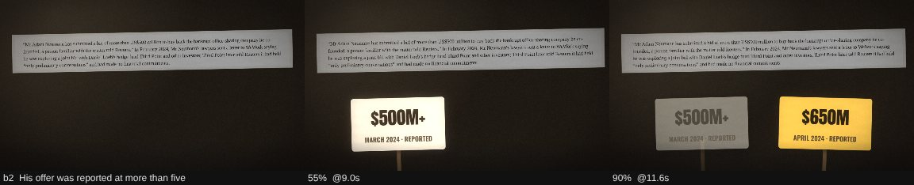 | `@bid_cards` | a real report of an offer lies dim across the frame; bid cards are raised into the frame one after another on their words, each higher than the last, the earlier one dimming | in, out, doc, crop, cards | bid,auction,offer,buyback,numbers,escalation | wework a6-02: reported at more than 500 million, then 650 million |
| 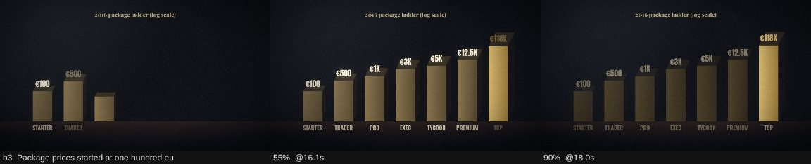 | `@blocks` | values become solid blocks that rise out of a dark floor one by one on the beat (photo or tone on their faces, a lit top, a dark side); one block is singled out on a word; an empty plinth can stand for a missing value | vals, labs, txts, show, go, gap, ats (one cue word per block, after show), hl, hlat, img, scale, empty, note, base, in, out, bg | data, comparison, bars, solids, ladder, sentences, scale | onecoin v2 (package ladder, the sentence line-up, Bitcoin vs OneCoin) |
| 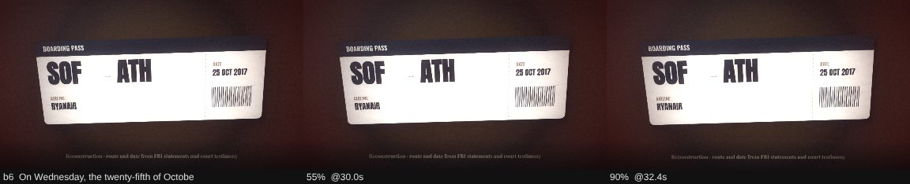 | `@boarding` | a boarding pass (a reconstruction, labelled as such) flies in turning over in 3D and lands on the desk; its fields type in; on the word its stub tears off and drifts away | from, to, date, fields, tear, recon, in, out | travel, escape, flight, document, reconstruction, tear | onecoin v2 (Sofia to Athens, 25 October 2017) |
| — | `@box_office` | real footage of an audience plays; ticket stubs fly across the frame faster and faster while a box-office total counts up and locks on its final value | clip, to, go, span, pre, unit, lab, sub, in, out | movie,box-office,tickets,count,revenue,hit | lego a6-02: in 2014 The LEGO Movie took about 468 million dollars worldwide |
| — | `@box_vs_parts` | a closed cardboard box lands on a dark desk with its small price tag; on the word its parts pour out beside it into a growing heap, and a much bigger tag drops onto the heap: the parts cost more than the box sells for | bg, box, go, heap, btag, htag, note, in, out | cost,price,loss-leader,box,parts,mismatch | lego a0-05: some sets cost more to source than the whole box sold for |
| — | `@brick_drop` | one plastic brick falls into a real picture from above, lands on a surface in it with a small bounce, a dust puff and a click, while the camera keeps pushing in; a short label sets beside it | bg, go, x, y, h, brick, lab, sub, lx, move, z, in, out | motif,brick,drop,carrier,object,landing | lego a0-12: it was saved by counting |
| — | `@brick_rain` | plastic bricks of four colours rain into a real picture and pile up from the floor, more and more, while an optional counter runs from one number to another and locks on its final value | bg, go, n, rate, from, to, cnt, span, unit, lab, suf, in, out | bricks,pile,growth,count,catalogue,sprawl | lego a0-03: a company famous for precision lost count of its own parts |
| 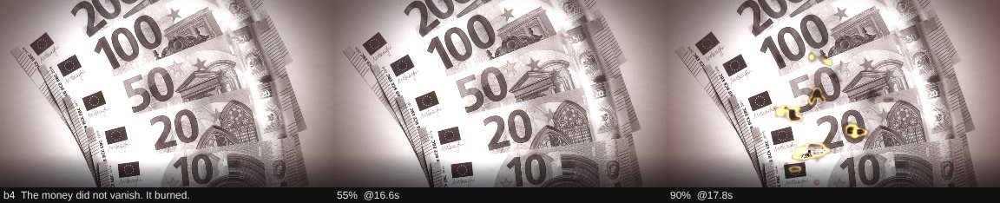 | `@burn_away` | a photo burns away from a point with a glowing charred edge, revealing the next picture | a, b, go | transition,fire,burn,money,loss | demo-kit (fx kit showcase) |
| — | `@case_cards` | a line-up of case files lands on the investigator's desk one per sentence: each card drops in with weight, carrying a name, a role and the sentence in large type; earlier cards stay, the newest is lit; one slot can stay an empty dashed card (never tried) | rows, show, go, empty, title, in, out | sentences, verdicts, line-up, cast, consequences, desk | onecoin v2 (so line up the sentences) |
| — | `@cash_pile` | real bundles of cash drop one after another onto a dark desk and stack into a pile while a counter runs up to the total; small tags on the pile name where the money came from | img, n, go, val, pre (default $), unit (default M), tags (~), lab, in, out | money,cash,pile,count,payout,stack | wework a2-06: by that July he had taken out about seven hundred million dollars |
| 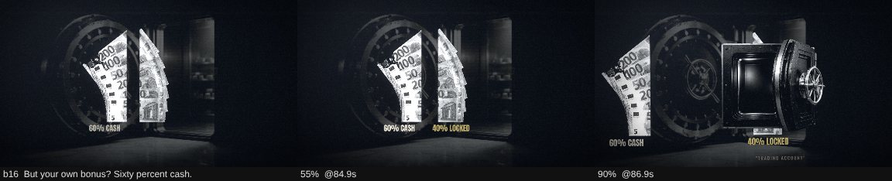 | `@cash_split_vault` | a real stack of notes is cut 60/40: one part slides to you, the other slides into a vault that shuts on the word | — | money,split,locked,payout,vault,percent | onecoin a2: Sixty percent cash. Forty percent locked inside the system |
| 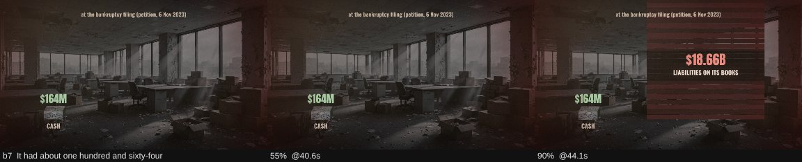 | `@cash_vs_wall` | two amounts at true scale on the floor of a real room: a small real stack of cash lands on its word, then a dark wall of blocks builds beside it until it runs out of frame | in, out, plate, a, b, ratio, cash, note | scale,comparison,cash,debt,liabilities,ratio | wework a5-07: 164 million in cash against 18.66 billion in liabilities |
| 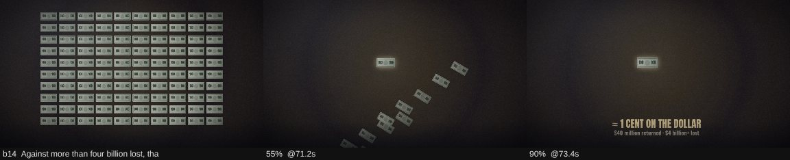 | `@cent_grid` | a hundred real banknotes laid out in a grid stand for the whole sum; on the word ninety-nine of them drop away off the floor one after another and a single note is left in the light | img, at, keep, share (how many notes stay), lab, sub, ld (label delay s, default 1.8), in, out | money, ratio, percent, loss, recovery, one-percent | onecoin v2 (one cent on the dollar) |
| 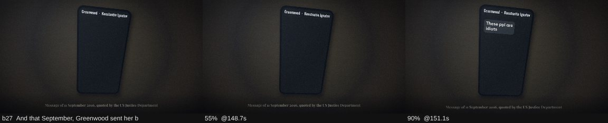 | `@chat` | a phone lying tilted in the lamp light shows a real message thread: bubbles arrive one by one on their cue words with a typing pause, names above each side; the source sits under the phone | msgs, cues, left, right, src, bg, in, out | messages, chat, phone, evidence, quote, verbatim | onecoin v2 (These ppl are idiots) |
| 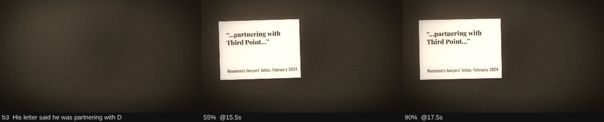 | `@claim_vs_denial` | two typed index cards on the desk: a claim lands with its source, then the answer lands beside it and a red line strikes the claim through; both verbatim | in, out, claim, reply, strike | claim,denial,quote,verbatim,contradiction,evidence | wework a6-03/04: partnering with Third Point / no commitment |
| 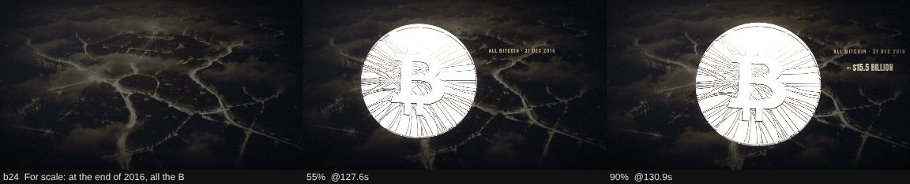 | `@coin_share_slice` | a real coin photo as a pie: a wedge cuts out on the spoken word and fills with banknote texture, showing a share of the whole | go, num, step | share,pie,comparison,scale,money | onecoin a2: all Bitcoin was worth 15.5B; OneCoin had raised more than a quarter of that |
| — | `@colour_halve` | over real footage a wall of colour chips, one per shade in the range, fills the frame; on the word every other chip drops out of the wall and falls, leaving half the shades | clip, n, go, lab, in, out | colours,range,simplify,cut,half,palette | lego a5-10: the colours were cut roughly in half |
|  | `@credentials_cv` | a CV card builds row by row on spring entries while a real photo of each place slides in beside it as a print; a correction sticker fixes an inflated claim; a hidden red row appears last | step, go, plate, fix, picAt, pic, cap | biography,credentials,cv,myth,correction,founder | onecoin a1: A real law doctorate…/Her Oxford degree was a master's/convicted of fraud |
| 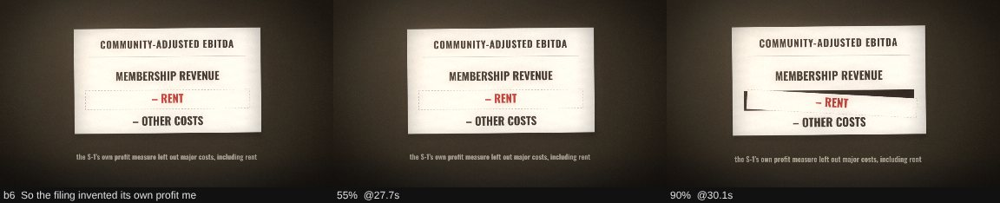 | `@cut_out_word` | a sheet of paper with a short list under a title; on the word one line is cut out of the sheet and falls out of frame, leaving a dark slot | in, out, lines, cut, go, title, note | accounting,exclusion,list,paper,cut,trick | wework a3-06: community-adjusted EBITDA left out costs like rent |
| — | `@cv_card` | a CV card fills the frame under the lamp and fills in row by row on the beat while the camera rides to the newest row; a yellow correction sticker can fix an inflated claim; the last row can arrive in red and be circled by the marker | name, rows, step, go, fix, fixrow, fixat, red, ring, in, out | biography, cv, credentials, correction, record, founder | onecoin v2 (the most credible person in any room) |
| 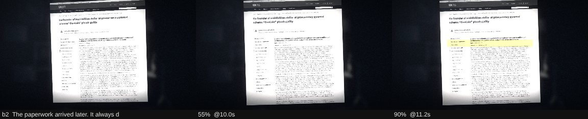 | `@doc_flip` | a real document flies in from deep space turning over in 3D (paper back first), lands with a shadow, a highlighter runs across one line | doc, land, bg, mark, line | document,3d,card,evidence,highlight | demo-kit (fx kit showcase) |
| 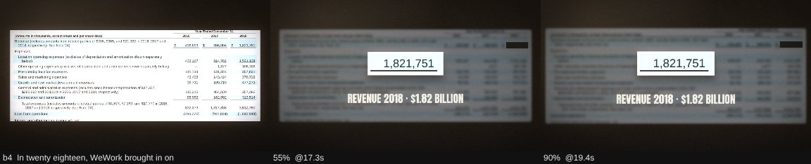 | `@doc_lift` | a real financial statement on the desk; on the word one figure is cut out of the page and lifts toward the camera as a raised slab, the page dimming behind; its plain-words label sets under it | in, out, doc, crop, cut, go, lab, col | document,figure,lift,accounts,number,evidence | wework a3-04: brought in 1.82 billion of revenue / lost 1.61 billion |
| — | `@doc_quote_line` | a real page lies dim and blurred behind; one line (or two) of it is lifted out as a wide paper strip across the frame, large enough to read, and a highlighter runs over the words that matter on their cue; the source sits under the strip | doc, line (x0,y0,x1,y1 of each segment of the passage, joined with +, stacked in reading order at one text size), marks (x0,y0,x1,y1@word ~ … in page coordinates), src, in, out | document,quote,line,evidence,highlight,readable | wework a3-09: future lease payments, already signed: forty-seven point two billion dollars |
| 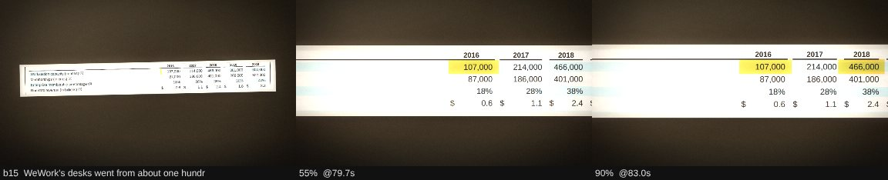 | `@doc_read` | a real page on a dark desk; the camera travels to the passage that matters and a highlighter runs across each marked figure on its word | doc, in, out, crop, marks, z, zoom, rot | document,evidence,highlight,filing,table,read | wework a1-15: desks went from about 100,000 to 466,000 |
| 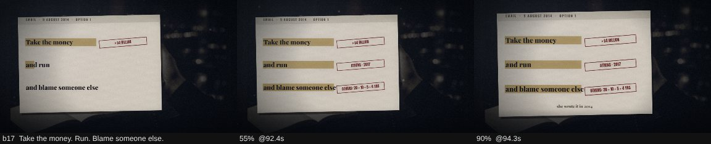 | `@document_verdict_stamps` | the opening document returns; each clause is highlighted on its word and gets what really happened stamped beside it | — | callback,document,verdict,ending,stamps | onecoin a6: Take the money. Run. Blame someone else. She wrote it in 2014. |
| — | `@dots` | a vast number becomes a field of gold points that fills the dark frame in waves from one point outward, faster and faster, while the count sets in large type — a crowd too big to film | n, go, lab, sub, cx, cy, in, out | scale, crowd, victims, count, millions, data | onecoin v2 (three and a half million investors) |
| 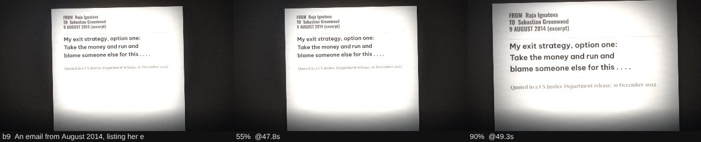 | `@email_page` | a quoted email as a printed page on the desk under the lamp; the camera reads into it and red marker circles (or underlines) chosen words on their cue words; a source line keeps it honest | head, lines, src, circle, under, zoom, zat, rot, in, out | document, email, evidence, quote, marker, motif | onecoin v2 (the exit-strategy email, re-read at every act turn) |
| 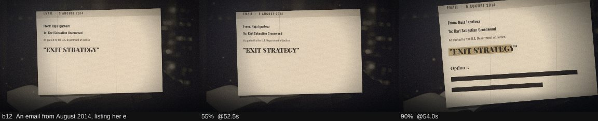 | `@evidence_email_drop` | a real email printed as evidence drops onto a dark desk with a spring; header lines stagger in; the key phrase gets a gold marker on its spoken word; the next lines are redacted bars | — | document,email,evidence,quote,reveal,desk | onecoin a0: An email from August 2014, listing her exit strategy |
| 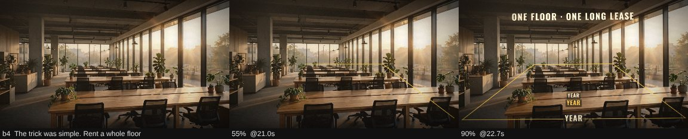 | `@floor_grid` | a real floor in perspective: its outline traced as one space, then cut into a grid of lit desks tagged with a monthly price, or a tape of YEAR marks running away along it | in, out, plate, quad, whole, mode, nx, ny, cut, tag, price, n, lab | floor,grid,desks,perspective,lease,unit-economics,real-estate | wework a1-05: cut it into desks, and rent the desks out by the month |
| — | `@folder_reveal` | a closed kraft folder marked PRIVATE lies on the desk; on the word its flap lifts and a real document slides out of it toward the camera, so a private record becomes public | doc, crop, stamp, go, in, out | private,public,disclosure,folder,document,reveal | wework a2-09: one day, someone else gets to read it |
| 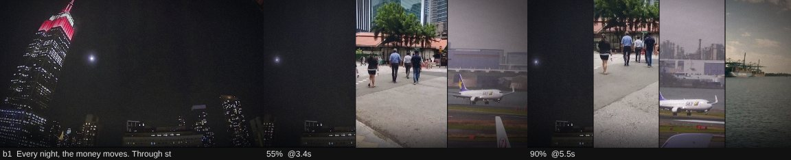 | `@footage_split` | one full-frame shot is sliced into panels on spoken words, each new panel sliding in from the right with its own footage | base, clips, keys, close | footage,split-screen,montage,stock,list | demo-stock (stock-as-material test) |
| 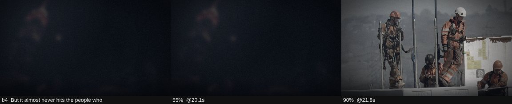 | `@framed_insert` | a second clip rises in a frame over the blurred first clip, then the camera pushes into the frame until it becomes the world | outside, inside, rise, fill | footage,picture-in-picture,window,object-becomes-world | demo-stock (stock-as-material test) |
| — | `@gift_tag_flip` | over real footage a gift tag hangs on its string with one word on it; on the word the tag spins round on the string and its back reads what it really was, with its terms | clip, front, back, terms, go, in, out | loan,gift,terms,reversal,tag,money | lego a5-07: not a gift, a loan, with interest, due in 2011 |
| 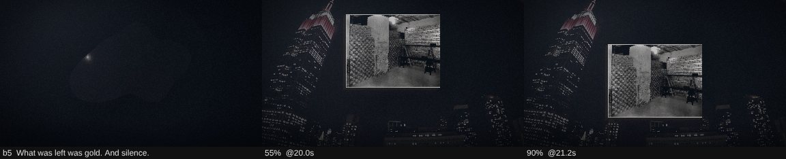 | `@gold_ink` | ink spreads to reveal footage; a real object with thickness drops onto the floor; RGB-split hit on the last word | ink, clip, go, obj, hit | ink,reveal,object,extrude,chroma,hit | demo-kit (fx kit showcase) |
| 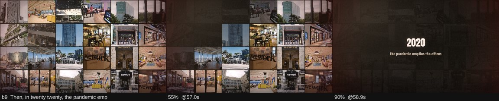 | `@grid_wall` | a wall of real pictures in a tight grid, all lit; on the word they go dark one after another in a wave (or at random) until a few or none are left, and the count sets over the dark wall | in, out, ids, cols, rows, keep, order, go, span, lab, sub | grid,wall,closure,count,photos,lights-out,scale | wework a4-09: the pandemic emptied the offices in every city |
| — | `@growth_stack` | two stacks of plastic bricks on a real floor: one brick for the earlier year lands first, then on the word the later year's stack drops in brick by brick until it is as many times taller as the number says; a fraction of a brick shows the remainder | bg, a, b, go, alab, blab, brick, lab, in, out | growth,multiple,scale,bricks,stack,revenue | lego a6-06: that's nearly twelve times its 2005 level |
| 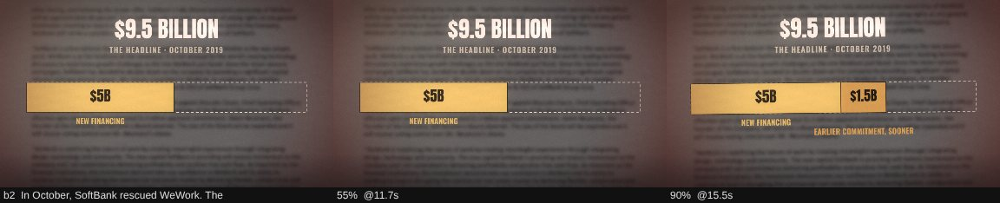 | `@headline_split` | a headline number as an empty dashed bar over a real document; on their words the real parts fill the bar from the left as solid segments with their figures, so what is left empty is the gap between the headline and the money | in, out, bg, head, total, parts | headline,breakdown,parts,gap,money,myth | wework a4-02: the headline said 9.5 billion; only 6.5 was for the company |
| — | `@headline_vs_real` | a ledger of the film's numbers: each row lands on its word with an empty dashed bar for the headline figure and a solid bar for the money that really moved, both at true scale, so the same gap repeats down the page | rows (label^headline^real^headline number^real number^word ~ …), max, title, in, out | comparison,headline,reality,ledger,pattern,bars | wework a4-14: a big headline, then a smaller real number. Again. |
| 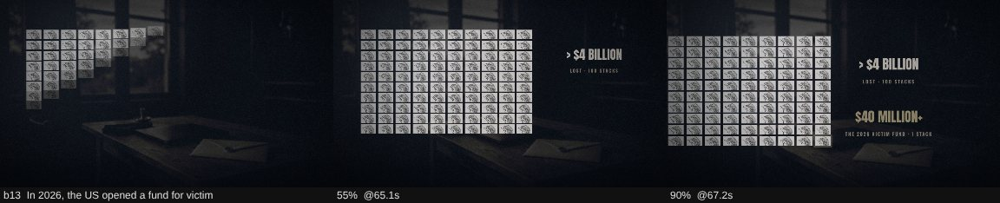 | `@hundred_stacks_one_lit` | a total as 100 stacks of real notes; the recovered share is one lit stack; on the word the other 99 go dark and the ratio lands | step | recovery,ratio,money,victims,comparison,one-percent | onecoin a6: just over 40 million… about one cent on the dollar |
| 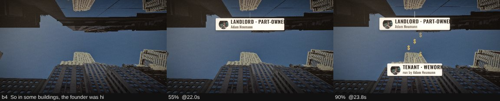 | `@landlord_tenant` | looking up at a building: a name card drops high on the facade (who owns it) and another at street level (who rents it), the same portrait on both if it is the same person; gold rent marks climb from tenant to owner | in, out, bg, face, top, bot, flow, topat, botat | landlord,tenant,conflict,self-dealing,building,real-estate | wework a2-04: the founder was his own company's landlord |
| — | `@map_burst` | from a pin on a real map the camera pulls back while lines shoot out from it in every direction, one after another, and a counter runs to the number of places reached | map, x, y, n, go, lab, in, out | map,spread,export,countries,count,growth,lines | lego a2-01: by 1966 LEGO was sold in forty-two countries |
| — | `@map_dive` | a real map zooms continuously toward one town; a pin drops on the word, then a circle opens from the pin into a real photo of the place, which keeps drifting | map, x, y, go, iris, photo, lab, sub, in, out | map,place,origin,zoom,pin,iris | lego a1-01: a carpenter's workshop in the Danish village of Billund |
| — | `@money_fork` | one source of money (a real photo on the left) and two destinations (real photos on the right); on their words an arrow draws from the source to each destination carrying its amount, so one headline sum visibly forks into two different uses | src, srclab, a, b (img^label^amount^word), note, in, out | money,flow,split,fork,diagram,where-it-went | wework a1-17: only one billion of that was new money; the other billion bought shares |
| 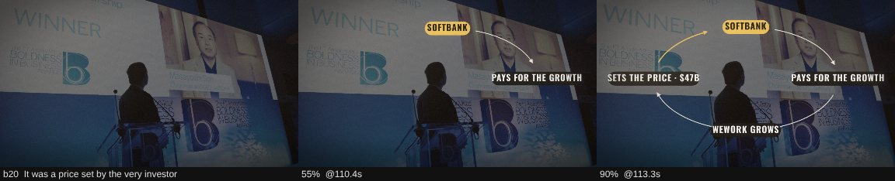 | `@money_loop` | a closed ring of labelled stations drawn over a real picture; arrows draw themselves on their words until the last one closes the loop in gold: a circle with no outsider in it | in, out, bg, nodes, close | loop,circular,mechanism,diagram,reflexive,money | wework a1-20: a price set by the very investor who was paying for the growth |
| 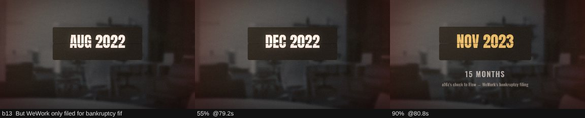 | `@month_flip` | a split-flap calendar runs from one month to another on the word, slows and locks on the end month in gold; the gap sets under it over dimmed footage | from, to, in, out, bg, go, lab, sub | time,calendar,countdown,gap,dates,flap | wework a0-13: WeWork only filed for bankruptcy fifteen months later |
| — | `@myth_strike` | real footage plays dim; the popular version of a story types in as short lines, and on their words a red line strikes each one through while the true fact lands under it | clip, lines, in, out | myth,correction,strike,truth,footage,claim | lego a0-11: it never went bankrupt, and no hit toy saved it |
| — | `@name_strap` | a real photo of a person with the camera travelling across it toward the face; on the name a paper name card slides in at the top edge with the name and the role, and stays | pic, go, name, role, fx, fy, in, out | person,name,introduction,portrait,role,camera | lego a2-06: in 1979 the founder's grandson Kjeld Kirk Kristiansen took charge |
| 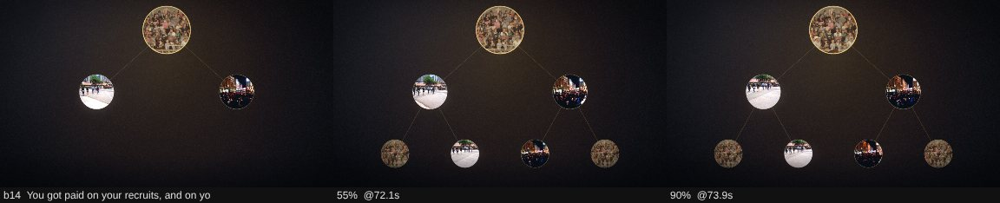 | `@network` | a recruitment pyramid grows downward level by level on the beat: every member is a living footage portrait in a circle, lines join recruit to recruiter, then gold flows up every line to the single node at the top | clips, levels, go, flow, top, toplab, in, out | mlm, pyramid, network, recruitment, money-flow, footage | onecoin v2 (every buyer was also a salesman) |
| 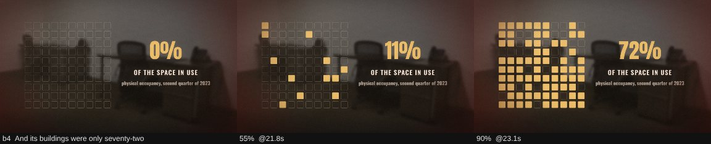 | `@occupancy_grid` | a real empty room behind and a block of 100 seats in front; on the word the occupied share lights gold seat by seat in a scatter while the percentage counts up | in, out, plate, pct, go, lab, sub | occupancy,percent,seats,utilisation,grid,empty | wework a5-04: its buildings were only 72 percent full |
| 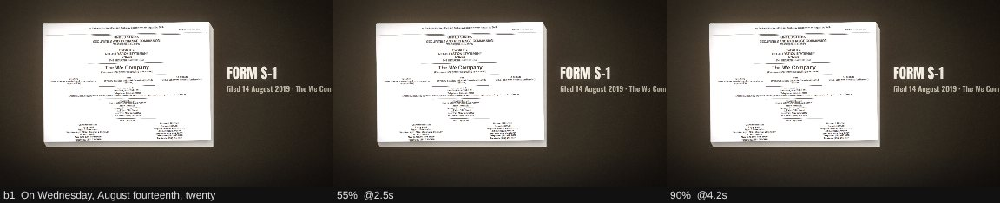 | `@page_stack` | a real document's first page drops onto a dark desk with weight and the rest of the filing builds up under it into a thick stack; a filing label types beside it | in, out, doc, crop, pages, grow, land, lab, sub | document,filing,stack,pages,weight,evidence | wework a3-01: WeWork filed its S-1 |
| 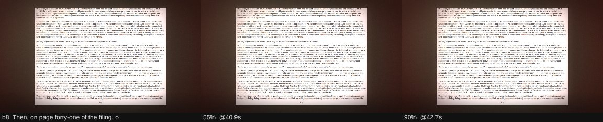 | `@page_turn` | the pages of a real filing flick past like a thumbed book, slow down and stop on the page that matters on its word; then the camera reads in and a highlighter runs over the marked line | in, out, pages, stop, marks, z, zoom | document,filing,pages,flip,highlight,find | wework a3-08/09: on page forty-one, one line decided everything |
| 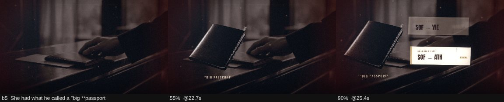 | `@passport_boarding_passes` | a passport lands; boarding passes slide out of it one per spoken city; only the chosen destination stays lit | — | travel,escape,flight,tickets,passport | onecoin a4: a big passport, and he bought her tickets to Vienna and to Athens |
| — | `@patent_snap` | a real patent drawing lies on a dark desk; the camera travels down the sheet from its filing header to the drawn brick, and on the word a real-size plastic brick drops onto the drawing and clicks into place; a filing date and a "today" chip set beside it | doc, go, fx, fy, h, brick, then, now, in, out | patent,drawing,brick,precision,compatibility,document,drop | lego a0-01: a brick made in 1958 still snaps onto a brick made today |
| 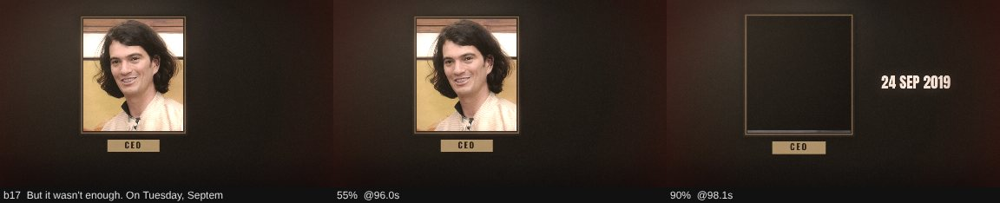 | `@photo_drain` | a framed portrait on a dark wall above a title plate; on the word the photo drains grey and slides out of the frame, leaving the empty frame and the plate | cap, in, out, pic, go, plate, date | exit,resignation,removal,portrait,frame,ceo | wework a3-17: Adam Neumann resigned as CEO |
| 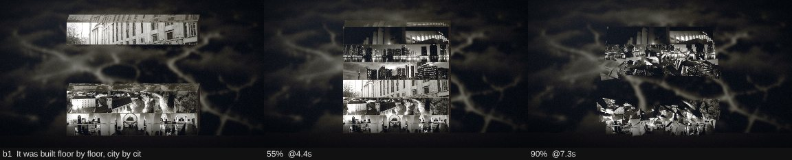 | `@photo_tower` | real photos become solid floors of a tower dropped in on the beat with the camera pulling back; one floor is pulled out and the rest shatter onto the ground | floors, go, pull, k, sky | photo,tower,physics,collapse,stack,shatter | demo-kit (fx kit showcase) |
| — | `@pie_on_photo` | a real photo of the thing being sold; a ring of shares is drawn round its centre, then on the word the share that was sold swings out of the ring and away while the kept shares stay lit with their owners | pic, slices, go, in, out | stake,shares,sale,ownership,pie,percent | lego a5-14: LEGO and its family holding company kept thirty percent |
| — | `@pile_sweep` | a big heap of plastic bricks fills a real picture; on the word a sweep clears most of them out of the frame, the rest settle, and a counter runs down from one number to another and locks | bg, n, keep, go, from, to, lab, pre, suf, in, out | cut,reduce,simplify,bricks,count,rescue | lego a5-09: the parts library was cut back to about seven thousand |
| 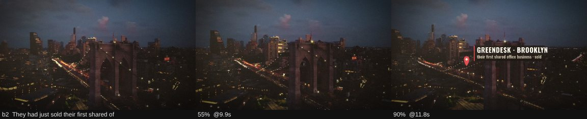 | `@place_pin` | a real place (footage or photo) with a map pin dropped on it on the word and an address card beside it | in, out, bg, x, y, go, lab, sub | map,pin,place,address,location,origin | wework a1-03: their first floor, at 154 Grand Street in SoHo |
| 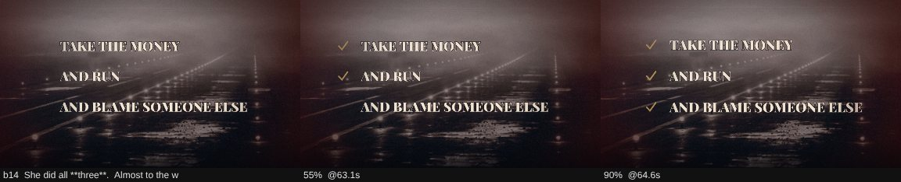 | `@plan_checklist` | the clauses of a plan as big serif lines over a runway plate; each gets a hand-drawn tick on its word, the last one lands on the punch word | — | plan,checklist,steps,motif,callback | onecoin a0: She did all three. Almost to the word. |
| 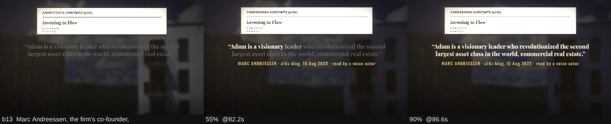 | `@post_quote` | the real header of a published post sits at the top as evidence; below it the verbatim words light from grey to ink as the quote voice reads them, with the attribution and a voiced note | in, out, bg, doc, crop, size, q, go, span, by | quote,post,blog,verbatim,voiced,attribution | wework a5-13: Adam is a visionary leader who revolutionized … commercial real estate |
| 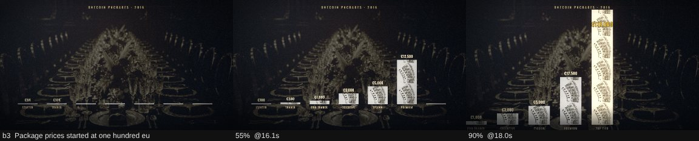 | `@price_ladder_cash` | a product price ladder as bars built from real banknote images; tiers stagger up, the top tier springs out of the frame with its price pinned at the top | — | money,price,tiers,bars,packages,scale | onecoin a2: Package prices started at one hundred euros and went up to 118,000 |
| — | `@price_query` | the camera dollies along a real shelf of boxes; on the word paper price tags swing in on strings, one per box, each showing only a question mark | bg, go, tags, mark, lab, pan, in, out | price,cost,unknown,tags,shelf,store,question | lego a0-04: LEGO couldn't tell you what its own boxes cost |
| — | `@print_slide` | real footage of the work plays full-frame; on the name an old photo print slides in from the side with a white border, turns and settles, a caption plate under it | clip, pic, go, side, cap, sub, in, out | portrait,archive,print,footage,person,introduction | lego a1-02: in 1932 Ole Kirk Christiansen began making wooden toys |
| — | `@profit_vs_value` | over a dim real picture, one profit bar per year rises above a zero line, year after year (a loss year dips below in red); then on the word a second line, value, starts from zero and sinks under them all to its final figure | bg, years, loss, go, vgo, vlab, val, lab, in, out | profit,value,economic-value,paradox,decade,chart | lego a4-11: LEGO reported profits in almost every one of those years, yet destroyed about 1.6 billion dollars of value |
| 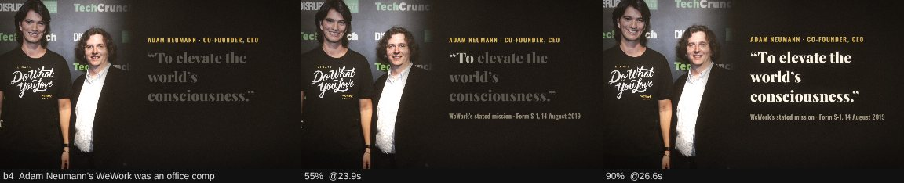 | `@quote_beside` | a real photo of the speaker fills one side; their verbatim words light from grey to ink word by word on the other, then hold still with the source under them | in, out, side, pw, pic, size, q, go, span, name, src | quote,verbatim,person,document,serif,attribution | wework a0-04: its mission was to elevate the world's consciousness |
| 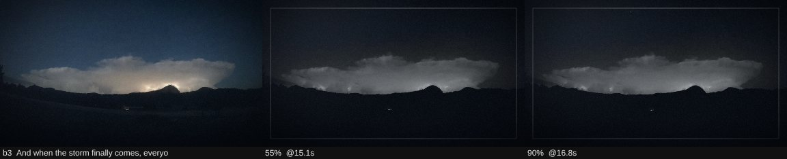 | `@ramp_freeze` | footage slows on one word and freezes on the next; the held frame drains to monochrome and a frame line draws round it like evidence | clip, slow, freeze | footage,speed-ramp,freeze,evidence,tension | demo-stock (stock-as-material test) |
| — | `@redact_bars` | a real news page lies on the desk under the lamp; on one word a red line strikes the reported figure through, on the next black redaction bars sweep across the rest of the text line by line, so a deal's later terms visibly vanish from the record | doc, crop (x0,y0,x1,y1), strike (x0,y0,x1,y1 of the line to strike, page coordinates), sat, go, rows, in, out | redaction,undisclosed,secret,settlement,strike,document | wework a4-07: cancelled, then settled on terms that were never fully disclosed |
| 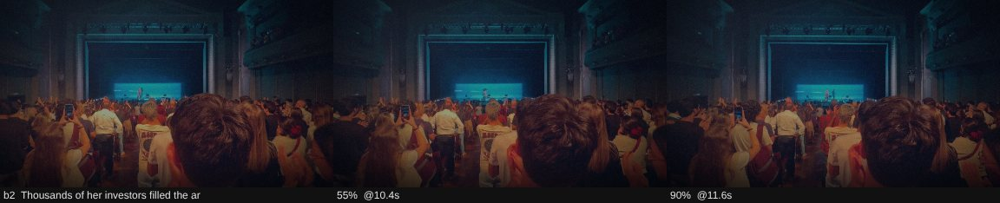 | `@reel` | footage as the hero picture: a camera move with intent, an optional speed ramp and freeze on words, a grade that changes on a word, one optional label set in the world, and doctrine seams in and out | clip, from, fy, move, z, slow, freeze, mono, grade, under, ua, txt, tx, ty, tsize, tat, tfont, tcol, sub, in, out, ink | footage, hero, camera, speed-ramp, freeze, seam, workhorse | onecoin v2 (all acts) |
| — | `@rise_and_sink` | two real pictures side by side as framed cards: on one word the left card sinks and drains to grey, on another the right card rises into the light, each with its label, so one fortune falls while the other climbs in the same frame | down, up, dlab, ulab, dat, uat, in, out | contrast,rise,fall,two-fortunes,comparison,timing | wework a0-06: how do you raise money for your next company before the first one has finished falling |
| 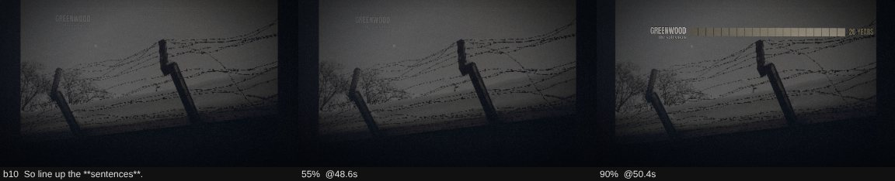 | `@sentence_ladder` | prison sentences of a whole cast as bars of years over a real prison photo; new rows land on their spoken words; the one never tried gets an empty dashed row | step, keys | verdict,sentences,court,comparison,cast,bars | onecoin a5: So line up the sentences |
| 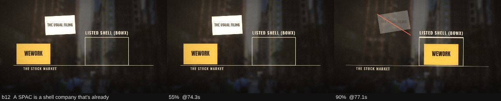 | `@shell_merge` | how a SPAC works: an empty box already standing on the stock-market line; a company card slides into it and the lid closes, while the usual filing card is struck through and set aside | in, out, bg, line, shell, go, co, skip, filing | spac,merger,shell,listing,mechanism,diagram | wework a4-12: a SPAC is a shell company already on the stock market |
| — | `@sign_on_footage` | real footage of a thing plays; on the word a physical placard on a post is planted into the scene from below and settles with a spring, carrying a short label (FOR SALE, CLOSED…) and a date under it | clip, sign, sub, go, x, y, in, out | sign,placard,for-sale,label,footage,literal | wework a3-18: the same day, the company put the jet up for sale |
| — | `@slice_returns` | one bar of sales per year stands on a real floor; on its word each bar fills its operating-profit share from the bottom in gold, year after year, with the share written beside it | bg, rows, go, lab, in, out | margin,profit,share,years,durability,bars | lego a6-07: between a quarter and a third of its sales came back as operating profit |
| 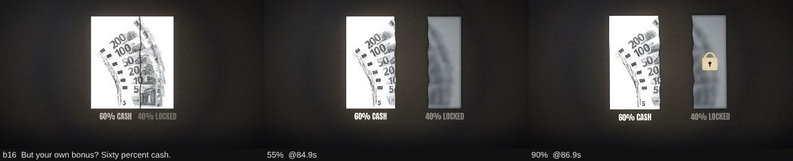 | `@split_note` | a real banknote (or any picture) splits along a ragged line into two shares; the left share stays in the light with its label, the right share slides behind frosted glass and a padlock closes over it on the word | img, cut, lab1, lab2, at, lock, in, out | money, split, locked, trap, share, ratio | onecoin v2 (60 % cash, 40 % locked in the system) |
| — | `@swing_bar` | over real footage one bar hangs below a zero line in red for the loss; on the word it swings up through zero and stands above it in gold for the profit, its number changing with it | bg, a, b, go, alab, blab, unit, in, out | profit,loss,swing,turnaround,bar,result | lego a5-15: in 2005 LEGO made a profit again, 505 million kroner net |
| 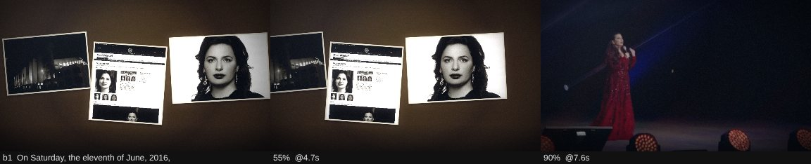 | `@table` | the investigator's desk under one lamp: real photos and documents lie on it as prints with borders and shadows; the camera travels across; on a word one print lifts, grows past the frame and becomes the world (its footage can come alive inside it); a red marker can circle a print | items, pan, lift, at, live, mark, mat, mono, txt, tat, ty, tsize, sub, in, out | desk, evidence, documents, photos, object-becomes-world, investigation, world | onecoin v2 |
| — | `@tax_chain` | one new brick drops into the middle of a real picture; on each named cost a heavy tag clamps onto it with a chain, and the brick sinks a little lower with every tag it has to carry | bg, chips, go, brick, lab, in, out | complexity,cost,overhead,tax,burden,mechanism | lego a4-13: every new piece charges the whole system, the mould, the colour, the supplier, the shelf space |
| 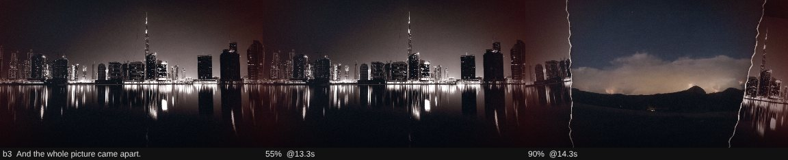 | `@tear_reveal` | the whole picture tears in two like paper with fibrous edges, revealing footage beneath | a, b, go | transition,paper,tear,footage,collapse | demo-kit (fx kit showcase) |
| 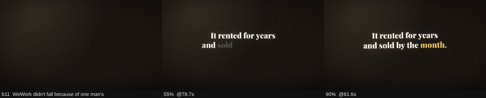 | `@thesis_black` | the channel's thesis on black: one or two lines of large serif type arrive word by word with a short blur-in and hold dead still, one word in the accent | in, out, lines, size, go, span, hi, sub | thesis,ending,type,black,stillness,signature | wework a6-11/12: it rented for years and sold by the month |
| — | `@timeline_pins` | a single time line runs across the frame; real documents are pinned onto it at their dates on their words, each with its date and what it was, and a bracket measures the gap between the first two | items (doc^crop x0,y0,x1,y1^x^date^label^word ~ …), gap, gapat, in, out | timeline,dates,sequence,documents,gap,before-after | wework a0-14: the comeback started before the crash had even finished |
|  | `@tokens_per_coin` | one coin equals a grid of tokens that grows from N to M dots on the spoken word: the hidden dilution made countable | — | dilution,ratio,tokens,count,hidden-cost | onecoin a2: the mining difficulty quietly rose: from 44 tokens per coin to 359 |
| — | `@tower_compare` | two towers of plastic bricks build themselves brick by brick over real footage, one per side; a side can stack two companies in two colours; each tower is as tall as its number, and the totals land on top | bg, l, r, unit, step, go, rgo, lab, in, out | comparison,revenue,scale,bricks,stack,rivals | lego a0-09: twenty years later LEGO was bigger than Mattel and Hasbro combined |
|  | `@two_accounts` | the frame splits down a paper spine into two accounts, a picture in each half; a value types into each account on its word and the side that loses drains to grey | crack (word: the spine splits wide and the company half drops), in, out, open, win, wat | ledger,split-screen,comparison,two-sides,motif,money | wework a0-08: we'll keep two accounts side by side |
|  | `@two_questions` | the lesson as two numbered questions over real footage of what they are about; each question card slides in on its word and stays | in, out, bg, lab, qs | lesson,questions,takeaway,checklist,ending | wework a6-14: who set the price, and how much cash changed hands |
|  | `@typed_price_staircase` | a hand-set price drawn as a gold staircase line (never a market wiggle) from a start price to an end price, over a dim photo of the office that set it | — | price,chart,manipulation,line,growth | onecoin a2: Fifty euro cents at launch. 29.95 by 2019 |
|  | `@valuation_tag` | a paper price tag swings in on a string in front of a real building and a value is written on it; later values strike the old one through, the tag swinging on each change | in, out, bg, vals, x, lab, sub | price,valuation,tag,repricing,strike,money | wework a1-16: at a valuation of forty-seven billion dollars |
|  | `@vote_fan` | voting power as cards: one ordinary share holds one ballot; the founder's share fans out into N ballot cards on the word | in, out, bg, n, llab, go, rlab, lab | governance,votes,control,shares,founder,cards | wework a3-13: Neumann's shares carried twenty votes each |
| — | `@web_scroll` | an archived web page sits in a browser window over a dark desk and scrolls down continuously; on the word a highlight band sweeps across one passage of it | doc, crop (x0,x1 of the page width to show), from, to, mark, go, url, in, out | web,page,archive,scroll,browser,catalogue,highlight | lego a2-09: new themes, new worlds, new pieces every year |
|  | `@window_count` | real footage of an apartment block at night; on the word windows light up across the frame faster and faster while the count runs up to its total | in, out, bg, n, go, span (count seconds, default 3), lab, sub | apartments,count,windows,real-estate,scale,night | wework a5-11: bought majority stakes in more than four thousand apartments |
| — | `@wiretap` | a phone lies on the desk mid-call; the caller's initials sit on the screen, a live waveform runs and the call timer counts; on a word a red REC lamp and a label slide in — someone else is listening | caller, sub, rec, lab, heart, in, out | surveillance, informant, phone, recording, betrayal, fbi | onecoin v2 (it was her boyfriend) |
|  | `@word_cut_montage` | one clip per key word, hard cut on the word with a zoom-through seam (blur out, land pushing in) | clips, keys | footage,montage,cut,rhythm,stock | demo-stock (stock-as-material test) |
|  | `@word_cuts` | one picture per spoken word (footage or photo), hard cut on its word, each arriving already pushing in toward its own focus point | items, in, out | montage,list,cut,footage,photo,rhythm | wework a0-03: the coffee is free, there's a beer tap, a sign says do what you love |
| — | `@word_join` | two words slide in from both sides over a real picture; on the word the letters that are not kept drop out of the line and the rest close up into one name | bg, a, b, keep, go, gloss, in, out | name,etymology,words,letters,brand,origin | lego a1-03: leg godt, play well |
|  | `@years_vs_month` | a business model as two objects on a real floor: a tall stack of YEAR blocks dropping in (what the company owes) beside one thin 1 MONTH tile that blinks out (what the customer owes) | in, out, plate, n, go, month, blink, llab, rlab | mismatch,duration,lease,mechanism,comparison,blocks | wework a1-09: remember that, it's the whole story |
